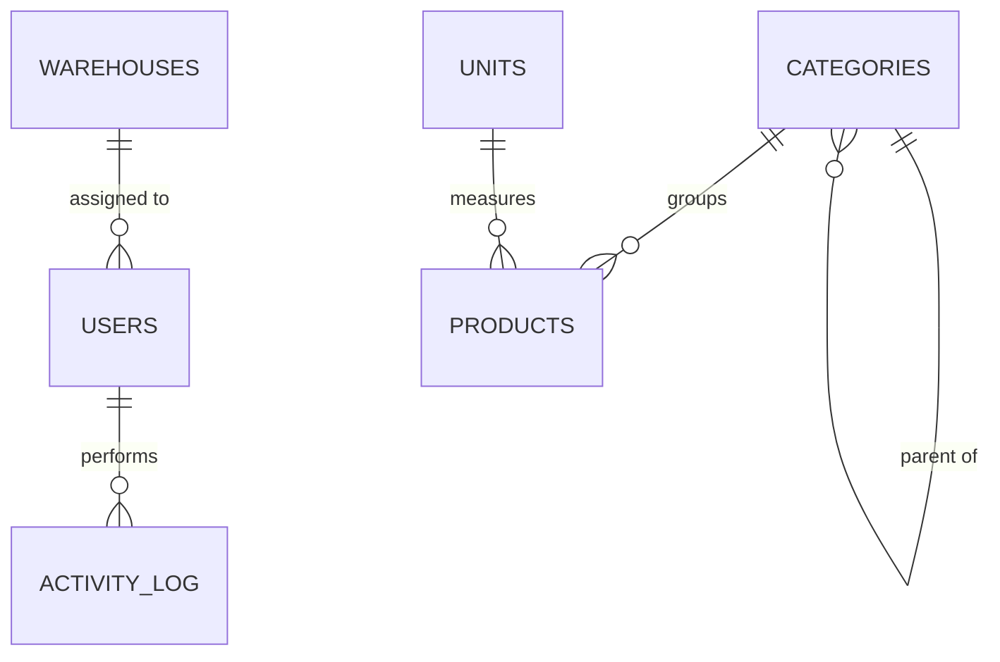
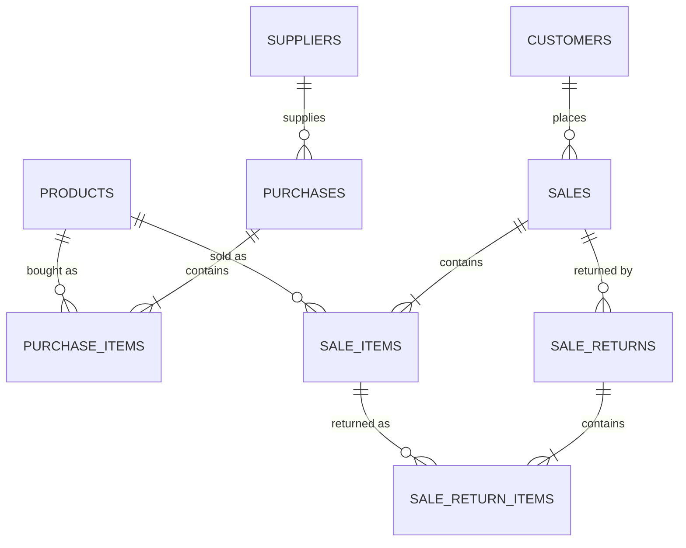
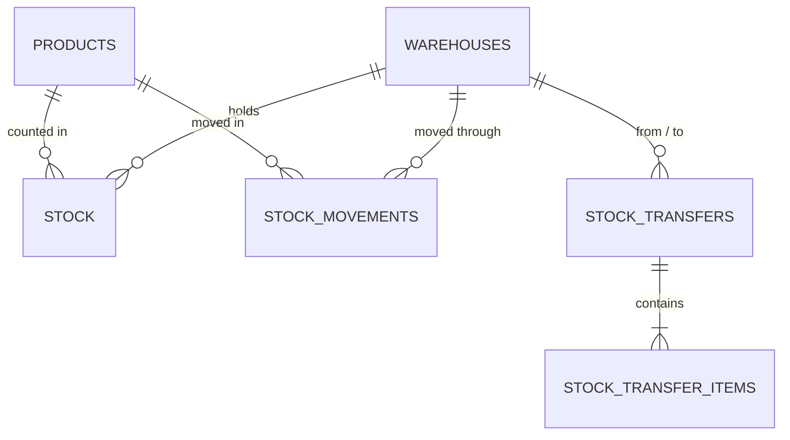

# SmartPOS — Database Design

**Status: approved and implemented.** All seven decisions in Section 8 were
settled on 28 September 2026 and the schema is written as migrations in
`docker/mysql/init/` — five files, 22 tables, 35 foreign keys, one view.
Section 7 records what changed from the first-cut scaffold schema; Section 8
records each decision and why it went the way it did.

Target: **MySQL 8.0, InnoDB, `utf8mb4` / `utf8mb4_unicode_ci`,
`READ-COMMITTED`.**

---

## 1. Design principles

| # | Principle | Consequence |
|---|---|---|
| 1 | **Money is `DECIMAL`, never `FLOAT`** | Line amounts `DECIMAL(12,2)`, document totals `DECIMAL(14,2)`, rates `DECIMAL(5,2)` |
| 2 | **Quantities are `DECIMAL(12,3)`** | Goods sold by weight (rice, sugar) work |
| 3 | **Master data is deactivated, never deleted** | `is_active` everywhere; historic documents always resolve |
| 4 | **Transactions are immutable once completed** | Correct a sale with a return or a cancellation, never an `UPDATE` |
| 5 | **`stock` is a cache; `stock_movements` is the truth** | The ledger can always rebuild the level |
| 6 | **Every money movement is a payment row** | `customer_payments` / `supplier_payments`, unioned by `v_cash_movements` |
| 7 | **Historic cost is copied onto the line** | Editing a product's price never rewrites past profit |
| 8 | **Surrogate integer PKs everywhere** | Business codes (SKU, invoice no) are `UNIQUE`, not primary |
| 9 | **`INT UNSIGNED` for master data, `BIGINT UNSIGNED` for transactions** | Sales, items, movements, payments and logs will outgrow 4 bytes |
| 10 | **`created_at` / `updated_at` on every table that is edited** | Cheap audit floor beneath `activity_log` |

---

## 2. Domain 1 — Access and master data



### `users`
Who may sign in, and what they may do.

| Column | Type | Notes |
|---|---|---|
| `id` | INT UNSIGNED PK AI | |
| `username` | VARCHAR(50) | **UNIQUE** |
| `full_name` | VARCHAR(120) | |
| `password_hash` | VARCHAR(255) | bcrypt; never the plaintext |
| `role` | ENUM('admin','manager','cashier') | Permissions resolved in code from `ROLE_PERMISSIONS` |
| `warehouse_id` | INT UNSIGNED NULL | FK → `warehouses`, ON DELETE SET NULL. The outlet a cashier is posted to |
| `is_active` | TINYINT(1) DEFAULT 1 | Disabled accounts cannot sign in |
| `last_login_at` | DATETIME NULL | |
| `created_at` / `updated_at` | DATETIME | |

*Roles are an ENUM, not a table, because the proposal fixes them at three and
permissions are enforced in application code.*

### `activity_log`
Answers "who did this". Append-only.

| Column | Type | Notes |
|---|---|---|
| `id` | BIGINT UNSIGNED PK AI | |
| `user_id` | INT UNSIGNED NULL | FK, ON DELETE SET NULL — the log outlives the account |
| `action` | VARCHAR(60) | `sale.create`, `user.disable`, … |
| `entity` / `entity_id` | VARCHAR(60) / BIGINT UNSIGNED NULL | What was touched |
| `detail` | TEXT NULL | JSON blob of the change |
| `created_at` | DATETIME | INDEX |

### `warehouses`
| Column | Type | Notes |
|---|---|---|
| `id` | INT UNSIGNED PK AI | |
| `code` | VARCHAR(20) | **UNIQUE** — `MAIN`, `GODOWN` |
| `name` | VARCHAR(120) | |
| `address` / `phone` | VARCHAR(255) / VARCHAR(30) NULL | |
| `is_active` | TINYINT(1) DEFAULT 1 | |

### `categories`
Self-referencing for the sub-category support in proposal 4.3.

| Column | Type | Notes |
|---|---|---|
| `id` | INT UNSIGNED PK AI | |
| `parent_id` | INT UNSIGNED NULL | FK → `categories`, ON DELETE SET NULL |
| `name` | VARCHAR(120) | |
| `is_active` | TINYINT(1) DEFAULT 1 | |

*One level of nesting is what the proposal promises. The self-FK allows more;
the application should enforce the limit and reject cycles.*

### `units`
| `id` INT UNSIGNED PK · `name` VARCHAR(40) · `short_name` VARCHAR(10) **UNIQUE** |
|---|

Seeded: pcs, kg, g, ltr, pkt, box, dzn.

### `products`
| Column | Type | Notes |
|---|---|---|
| `id` | INT UNSIGNED PK AI | |
| `sku` | VARCHAR(40) | **UNIQUE** |
| `barcode` | VARCHAR(64) NULL | **UNIQUE**; NULL allowed, and MySQL permits many NULLs in a unique index |
| `name` | VARCHAR(160) | INDEX — the counter searches on it |
| `category_id` / `unit_id` | INT UNSIGNED NULL | FK, ON DELETE SET NULL |
| `purchase_price` | DECIMAL(12,2) | Latest cost; **not** used for historic profit |
| `sale_price` | DECIMAL(12,2) | |
| `tax_rate` | DECIMAL(5,2) | Percent |
| `reorder_level` | DECIMAL(12,3) | Drives the low-stock alert |
| `image_path` | VARCHAR(255) NULL | File on disk, not a BLOB |
| `is_active` | TINYINT(1) DEFAULT 1 | |

Indexes: `uq_sku`, `uq_barcode`, `idx_category`, `idx_name`.
The barcode lookup is the counter's hot path and must stay a unique-index hit.

### `customers` / `suppliers`
Same shape; kept as two tables because their balances run in opposite
directions and every query is one or the other.

| Column | Type | Notes |
|---|---|---|
| `id` | INT UNSIGNED PK AI | |
| `name` | VARCHAR(120) | INDEX |
| `phone` | VARCHAR(30) NULL | INDEX — how a cashier finds someone |
| `email` / `address` | VARCHAR(120) / VARCHAR(255) NULL | |
| `opening_balance` | DECIMAL(12,2) DEFAULT 0 | Carried in from the paper books |
| `is_walk_in` | TINYINT(1) | **`customers` only.** Exactly one row has 1 |
| `is_active` | TINYINT(1) DEFAULT 1 | |

---

## 3. Domain 2 — Trading documents



### `purchases` / `purchase_items`

`purchases`

| Column | Type | Notes |
|---|---|---|
| `id` | BIGINT UNSIGNED PK AI | |
| `reference_no` | VARCHAR(30) | **UNIQUE**, from `document_sequences` |
| `supplier_id` | INT UNSIGNED | FK, RESTRICT |
| `warehouse_id` | INT UNSIGNED | FK — stock lands here |
| `user_id` | INT UNSIGNED NULL | FK, SET NULL |
| `purchase_date` | **DATETIME** | *changed from DATE — see 7.6* |
| `subtotal`, `discount`, `tax_amount`, `grand_total` | DECIMAL(14,2) | |
| `paid_amount` | DECIMAL(14,2) | **Cached sum of `supplier_payments`** — see 4.2 |
| `payment_status` | ENUM('paid','partial','due') | Derived from `paid_amount` |
| `note` | TEXT NULL | |

`purchase_items`

| `id` BIGINT PK · `purchase_id` FK CASCADE · `product_id` FK RESTRICT · `quantity` DECIMAL(12,3) · `unit_cost` DECIMAL(12,2) · `discount` · `tax_amount` · `line_total` DECIMAL(14,2) |
|---|

A product may legitimately appear twice on one purchase at two costs, so there
is **no** unique key on (purchase_id, product_id).

### `sales` / `sale_items`

`sales`

| Column | Type | Notes |
|---|---|---|
| `id` | BIGINT UNSIGNED PK AI | |
| `invoice_no` | VARCHAR(30) | **UNIQUE**, from `document_sequences` |
| `customer_id` | INT UNSIGNED | FK — walk-in row for counter sales |
| `warehouse_id` | INT UNSIGNED | FK — stock leaves here |
| `user_id` | INT UNSIGNED NULL | FK, SET NULL — which cashier |
| `sale_date` | DATETIME | INDEX; time matters for shift reports |
| `subtotal`, `discount`, `tax_amount`, `grand_total` | DECIMAL(14,2) | |
| `discount_type` | ENUM('fixed','percent') | *new — see 7.3* |
| `discount_value` | DECIMAL(12,2) | *new* — what was typed; `discount` is what it computed to |
| `paid_amount`, `change_amount` | DECIMAL(14,2) | |
| `payment_method` | ENUM('cash','card','mobile','mixed') | `mixed` is explained by several `customer_payments` rows |
| `payment_status` | ENUM('paid','partial','due') | |
| `status` | ENUM('completed','held','cancelled') | INDEX — **held sales hold no stock** |
| `note` | TEXT NULL | |

Indexes: `uq_invoice_no`, `idx_customer`, `idx_sale_date`,
`idx_status_date (status, sale_date)` *new — every report filters on both*.

`sale_items`

| Column | Type | Notes |
|---|---|---|
| `id` | BIGINT UNSIGNED PK AI | |
| `sale_id` | BIGINT UNSIGNED | FK CASCADE |
| `product_id` | INT UNSIGNED | FK RESTRICT |
| `quantity` | DECIMAL(12,3) | |
| `unit_price` | DECIMAL(12,2) | |
| **`unit_cost`** | DECIMAL(12,2) | **Copied at sale time.** Principle 7 — this is what makes profit reports stable |
| `discount`, `tax_amount` | DECIMAL(12,2) | |
| `line_total` | DECIMAL(14,2) | |

### `sale_returns` / `sale_return_items`

`sale_returns`

| Column | Type | Notes |
|---|---|---|
| `id` | BIGINT UNSIGNED PK AI | |
| `reference_no` | VARCHAR(30) | **UNIQUE** |
| `sale_id` | BIGINT UNSIGNED | FK RESTRICT — a return always names its sale |
| `warehouse_id` | INT UNSIGNED | FK — where the goods go back |
| `user_id` | INT UNSIGNED NULL | FK, SET NULL |
| `return_date` | DATETIME | INDEX |
| `total_amount` | DECIMAL(14,2) | |
| `refund_method` | ENUM('cash','due_adjustment') | |
| `reason` | VARCHAR(255) NULL | |

`sale_return_items`

| `id` · `sale_return_id` FK CASCADE · `sale_item_id` FK RESTRICT · `product_id` FK · `quantity` · `unit_price` · `line_total` |
|---|

**UNIQUE (sale_return_id, sale_item_id)** *(new — see 7.4)*: one line per sold
line per return. Partial returns across several returns are still allowed,
because they are separate `sale_return` rows; the running total is validated in
`returnable_quantities()`.

---

## 4. Domain 3 — Stock and money



### 4.1 `stock` and `stock_movements` — the core invariant

`stock` — current quantity on hand.

| Column | Type | Notes |
|---|---|---|
| `id` | BIGINT UNSIGNED PK AI | |
| `product_id` | INT UNSIGNED | FK CASCADE |
| `warehouse_id` | INT UNSIGNED | FK RESTRICT |
| `quantity` | DECIMAL(12,3) DEFAULT 0 | |
| `updated_at` | DATETIME | |

**UNIQUE (product_id, warehouse_id)** — this is the lock target. A sale runs
`SELECT ... FOR UPDATE` on this row, so two counters cannot both sell the last
unit. Rows are created lazily with `INSERT ... ON DUPLICATE KEY UPDATE`.

`stock_movements` — append-only ledger, one row per change.

| Column | Type | Notes |
|---|---|---|
| `id` | BIGINT UNSIGNED PK AI | |
| `product_id` / `warehouse_id` | INT UNSIGNED | FK |
| `movement_type` | ENUM('purchase','sale','sale_return','transfer_in','transfer_out','adjustment','opening') | |
| `quantity` | DECIMAL(12,3) | **Signed**: positive in, negative out |
| `balance_after` | DECIMAL(12,3) | Running balance, written while holding the `stock` row lock |
| `reference_type` / `reference_id` | VARCHAR(30) / BIGINT UNSIGNED NULL | The document that caused it |
| `user_id` | INT UNSIGNED NULL | FK, SET NULL |
| `note` | VARCHAR(255) NULL | Required for `adjustment` |
| `created_at` | DATETIME | |

Indexes: `(product_id, warehouse_id)`, `created_at`,
`(reference_type, reference_id)`, plus
`(product_id, warehouse_id, created_at)` *new — the ledger screen orders by it*.

> **The invariant the whole system rests on**
> ```sql
> SELECT product_id, warehouse_id
> FROM   stock_movements
> GROUP  BY product_id, warehouse_id
> HAVING SUM(quantity) <> (SELECT quantity FROM stock s
>                          WHERE s.product_id = stock_movements.product_id
>                            AND s.warehouse_id = stock_movements.warehouse_id);
> ```
> **This must return zero rows at all times.** It is the acceptance test for
> M7 and belongs in CI.

### `stock_transfers` / `stock_transfer_items`
One transfer writes two movements per product: `transfer_out` from the source,
`transfer_in` at the destination, in one transaction.

| `stock_transfers`: `id` · `reference_no` UNIQUE · `from_warehouse_id` FK · `to_warehouse_id` FK · `user_id` · `transfer_date` DATETIME · `note` |
|---|

`stock_transfer_items`: **UNIQUE (transfer_id, product_id)** *(new)* — a product
appears once per transfer; two lines for the same product is a data-entry error.
CHECK `from_warehouse_id <> to_warehouse_id` *(new)*.

### 4.2 `customer_payments` and `supplier_payments`

Every taka in or out. Two tables, not one, so each carries a real foreign key to
its party (decision 8.2).

`customer_payments` — counter tender, later due collection, cash refund on a return.

| Column | Type | Notes |
|---|---|---|
| `id` | BIGINT UNSIGNED PK AI | |
| `customer_id` | INT UNSIGNED | **FK → `customers`**, RESTRICT |
| `direction` | ENUM('in','out') DEFAULT 'in' | `out` = cash refunded to the customer |
| `amount` | DECIMAL(14,2) | Always positive; `direction` carries the sign |
| `method` | ENUM('cash','card','mobile','bank') | |
| `reference_type` / `reference_id` | VARCHAR(30) / BIGINT NULL | `sale`, `sale_return`, or NULL for a plain collection |
| `user_id` | INT UNSIGNED NULL | FK, SET NULL |
| `paid_at` | DATETIME | INDEX |

`supplier_payments` — the mirror: money out to a supplier, `direction = 'in'`
for a credit note coming back. Same columns with `supplier_id` in place of
`customer_id`.

**A `mixed` sale is several `customer_payments` rows** against the same
`reference_id` — 500 cash + 300 card. That is why `sales.payment_method` can be
`mixed` without any extra table.

**Cached totals.** `sales.paid_amount` and `purchases.paid_amount` cache
`SUM(amount)` from the matching payment table, so the sale list needs no
subquery per row. They are recomputed inside the same transaction that inserts
the payment — never edited by hand.

**The cost of two tables.** Any combined cash position needs a `UNION`. It is
written once, as a view, so no report repeats it:

```sql
CREATE OR REPLACE VIEW v_cash_movements AS
    SELECT 'customer' AS party_type, customer_id AS party_id, direction, amount,
           method, reference_type, reference_id, user_id, paid_at
      FROM customer_payments
    UNION ALL
    SELECT 'supplier' AS party_type, supplier_id AS party_id, direction, amount,
           method, reference_type, reference_id, user_id, paid_at
      FROM supplier_payments;
```

### 4.3 `document_sequences` — **new table, see 7.1**

`next_invoice_no()` must be gapless and safe when two counters bill at once.
`MAX(invoice_no) + 1` is not.

| Column | Type | Notes |
|---|---|---|
| `doc_type` | VARCHAR(20) | PK part — `sale`, `purchase`, `sale_return`, `transfer` |
| `period` | VARCHAR(7) | PK part — `2026` or `2026-09`; `''` for never-resetting |
| `prefix` | VARCHAR(10) | `INV-`, `PUR-`, `RET-`, `TRF-` |
| `next_number` | BIGINT UNSIGNED DEFAULT 1 | |
| `padding` | TINYINT DEFAULT 6 | `INV-2026-000042` |

PRIMARY KEY (`doc_type`, `period`).

Allocation, inside the document's own transaction:
```sql
SELECT next_number FROM document_sequences
 WHERE doc_type = ? AND period = ? FOR UPDATE;
UPDATE document_sequences SET next_number = next_number + 1
 WHERE doc_type = ? AND period = ?;
```
Because it shares the document's transaction, a rolled-back sale returns its
number — gapless, which is what a VAT-style invoice book requires.

### `settings`
| `setting_key` VARCHAR(60) PK · `setting_value` TEXT NULL · `updated_at` DATETIME |
|---|

Key–value, read once per session and cached. Holds shop name, address, phone,
currency symbol, default tax rate, invoice prefix and footer.

---

## 5. Full table list — 22 tables

| # | Table | Migration | Rows (est. year 1) | PK width |
|---|---|---|---|---|
| 1 | `warehouses` | 001 | < 10 | INT |
| 2 | `users` | 001 | < 20 | INT |
| 3 | `activity_log` | 001 | ~200k | BIGINT |
| 4 | `categories` | 001 | < 200 | INT |
| 5 | `units` | 001 | < 20 | INT |
| 6 | `products` | 001 | ~5k | INT |
| 7 | `customers` | 001 | ~5k | INT |
| 8 | `suppliers` | 001 | < 500 | INT |
| 9 | `purchases` | 002 | ~2k | BIGINT |
| 10 | `purchase_items` | 002 | ~20k | BIGINT |
| 11 | `sales` | 002 | ~100k | BIGINT |
| 12 | `sale_items` | 002 | ~400k | BIGINT |
| 13 | `sale_returns` | 002 | ~2k | BIGINT |
| 14 | `sale_return_items` | 002 | ~5k | BIGINT |
| 15 | `stock` | 003 | products × warehouses | BIGINT |
| 16 | `stock_movements` | 003 | ~450k | BIGINT |
| 17 | `stock_transfers` | 003 | ~500 | BIGINT |
| 18 | `stock_transfer_items` | 003 | ~3k | BIGINT |
| 19 | **`customer_payments`** | 004 | ~110k | BIGINT |
| 20 | **`supplier_payments`** | 004 | ~4k | BIGINT |
| 21 | **`document_sequences`** | 004 | < 20 | composite |
| 22 | `settings` | 004 | < 30 | VARCHAR |

Plus one view, `v_cash_movements`, which unions the two payment tables so that
"what cash moved today" stays a single `SELECT` (see 8.2).

## 6. Referential integrity policy

| Relationship | ON DELETE | Why |
|---|---|---|
| `*_items` → parent document | **CASCADE** | Lines have no life without their header |
| any → `products`, `customers`, `suppliers`, `warehouses` | **RESTRICT** (default) | Master data is deactivated, never deleted (principle 3) |
| any → `users` | **SET NULL** | The record outlives the employee |
| `categories.parent_id`, `products.category_id`, `products.unit_id` | **SET NULL** | Losing a grouping must not lose the product |
| `stock` → `products` | **CASCADE** | A product that is genuinely purged takes its level with it |

---

## 7. What changed from the scaffold SQL

All applied in the migrations.

| # | Change | Reason |
|---|---|---|
| **7.1** | Added `document_sequences` | `next_invoice_no()` cannot be gapless or concurrency-safe otherwise |
| **7.2** | Added `idx_sales_status_date`, `idx_sales_warehouse_date`, `idx_movements_ledger` | Every report filters status + date range; the ledger orders by time |
| **7.3** | Added `discount_type` + `discount_value` to `sales` | Shops give "10% off"; storing only the computed amount loses the intent |
| **7.4** | Added `uq_return_item` and `uq_transfer_item` | Blocks a double-entry error that would silently double stock |
| **7.5** | Added `CHECK (from_warehouse_id <> to_warehouse_id)` | A transfer to itself writes two cancelling movements for no purpose |
| **7.6** | `purchases.purchase_date` DATE → DATETIME | Lets a purchase and a sale on the same day be ordered against each other |
| **7.7** | `warehouses` created before `users`; trailing `ALTER TABLE` dropped | Removes a fix-up from the migration |
| **7.8** | `payments` split into `customer_payments` + `supplier_payments` | Decision 8.2 — real foreign keys to each party |
| **7.9** | `movement_type` gained `sale_cancel` | Decision 8.3 — a cancellation must be distinguishable from a return |

## 8. Decisions — settled 28 September 2026

**8.1 — Sequence reset period. → Reset each year.**
`INV-2026-000001`, restarting each January. `document_sequences.period` holds
the year, and the application creates the next year's row on first use in it.
Matches how local VAT invoice books are kept and keeps numbers short.

**8.2 — `payments` structure. → Two tables with real foreign keys.**
`customer_payments` and `supplier_payments`, each with an enforced FK to its
party, instead of one polymorphic table. *This went against the recommendation
in the review draft.* The reasoning accepted: the database should enforce the
link rather than trusting the application to write `party_type` and `party_id`
together. The cost is that any combined cash position needs a `UNION` — paid
once, in the `v_cash_movements` view, so no report repeats it.

**8.3 — Cancelling a completed sale. → Writes reversing stock movements.**
A cancellation behaves like a full return: the goods go back on the shelf and
the ledger stays complete. This required a new `movement_type` value,
`sale_cancel`, kept distinct from `sale_return` so the ledger can tell a
cancellation from a genuine customer return.

**8.4 — Opening stock. → Manual entry screen, row by row.**
A dedicated screen writing one `opening` movement per product. *This went
against the recommendation of a CSV import.* Noted risk: past a few hundred
products this is a day of typing before the system can be used at all, and a
mistyped opening quantity is invisible — it looks like legitimate stock. CSV
import of opening stock moves to Future Works, and the `opening` movement type
is already in the schema, so adding it later changes no tables.

**8.5 — `balance_after` on `stock_movements`. → Keep it.**
The running balance is stored, so the ledger screen is a plain `SELECT`. It is
correct only because it is written while holding the `stock` row lock, which
the sale, return, purchase and transfer paths all already hold. Any future code
that writes stock outside `StockService.apply_movement()` breaks it — which is
exactly what the Section 4.1 invariant test catches.

**8.6 — Tax. → Plain percent per product.**
`products.tax_rate DECIMAL(5,2)`. No `tax_rates` table: the proposal scopes
VAT/Mushak invoicing out to Future Works, and a rate change is one `UPDATE`.

**8.7 — Retention. → No purge policy.**
`activity_log` and `stock_movements` grow at roughly 650k rows a year, which
MySQL will not notice within this project's lifetime. An unnecessary purge
risks deleting the audit trail the system exists to provide.

## 9. The migrations

Written and in the repository. They run in filename order from
`docker-entrypoint-initdb.d` on first start of the MySQL container, and
`scripts/init_db.py` applies the same files to a MySQL server that Docker did
not create.

```
docker/mysql/init/
├── 001_master_data.sql    warehouses, users, activity_log, categories,
│                          units, products, customers, suppliers        (8)
├── 002_transactions.sql   purchases, sales, sale_returns + item tables (6)
├── 003_stock.sql          stock, stock_movements, transfers + items    (4)
├── 004_payments.sql       customer_payments, supplier_payments,
│                          document_sequences, settings, cash view      (4)
└── 005_seed.sql           MAIN warehouse, 7 units, walk-in customer,
                           admin user, 4 sequences, shop settings
```

Verified without executing them (Docker was not running): 22 tables, 35 foreign
keys, every reference resolving against a table created earlier in the order,
no duplicate table names, balanced parentheses, and each of the twelve Section 7
and 8 items present.

**Still unverified:** the SQL has never been run. `docker compose up -d` is the
real test; if a statement fails, `docker compose logs db` names it.
