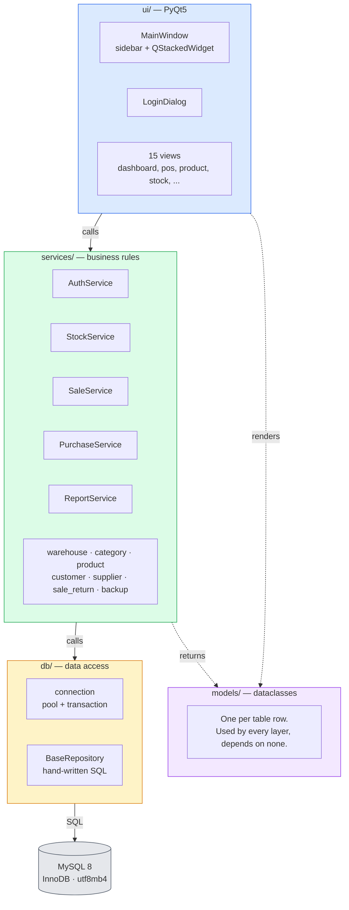
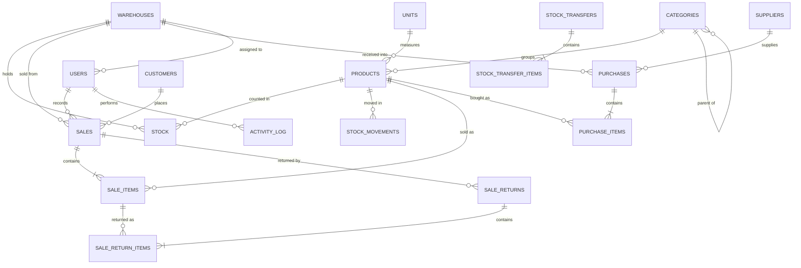
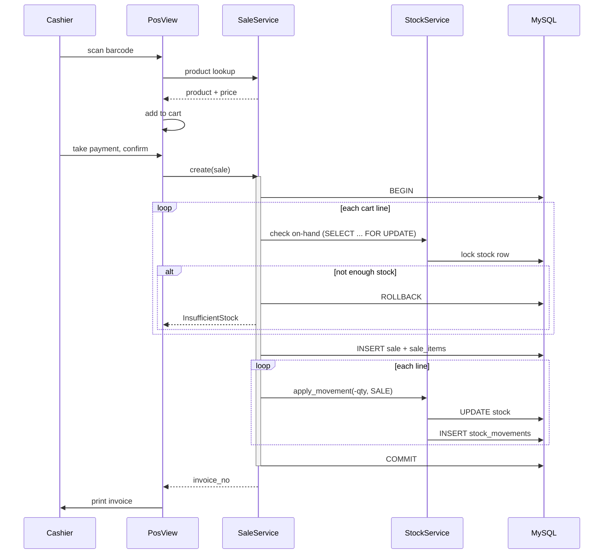
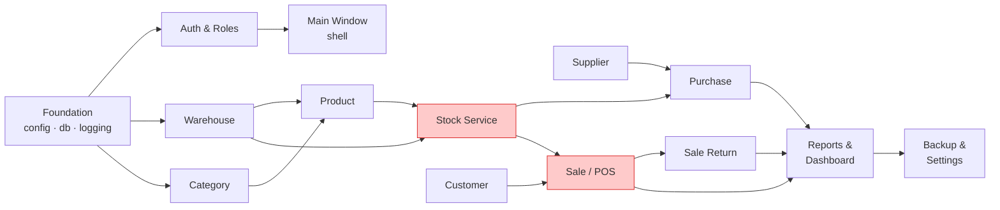

# SmartPOS — Implementation Plan

Derived from *Project Proposal — SmartPOS: A Desktop Point of Sale and
Inventory Management System* (BUBT, submitted 25 September 2026).

This document is the working plan: what the architecture is, what each module
must do, in what order the modules get built, and how you know a module is
finished. Layer rules and data-consistency invariants live in
[ARCHITECTURE.md](ARCHITECTURE.md); this file is the execution plan.

---

## 1. Scope

**Committed** — the 12 modules from Section 4 of the proposal:
auth & roles, warehouse, product category, product, customer, supplier,
purchase, sale (POS counter), sale return, stock management, reports &
dashboard, backup & utilities.

**Explicitly out of scope** (Section 7.1) — mobile access, multi-branch cloud
sync, full accounting (chart of accounts / journal / balance sheet), online
payment gateways, Bangla UI, purchase return.

Everything below builds only what Section 4 committed to. If a task does not
trace back to a numbered feature in the proposal, it does not belong in this
semester.

---

## 2. Architecture

### 2.1 Layers

Each layer talks only to the one below it. This is the rule that keeps the
project testable and keeps five people from colliding.



**Why these boundaries**

| Rule | Reason |
|---|---|
| No SQL in `ui/` | A view that queries directly cannot be changed without re-testing the database |
| No Qt imports in `services/` | Business rules stay testable with no display — this is what makes CI possible |
| `models/` imports nothing from other layers | Prevents circular imports as the project grows |
| All multi-table writes in one `transaction()` | A sale that half-writes corrupts stock permanently |

### 2.2 Data model



Two tables carry the weight of the whole system:

- **`stock`** — quantity on hand, one row per (product, warehouse). Fast lookup.
- **`stock_movements`** — append-only ledger. Every change to `stock`, with the
  document that caused it.

They are always written together. `stock` answers *how much*;
`stock_movements` answers *why*.

### 2.3 The critical path: completing a sale

Everything else in the system is CRUD. This flow is the one that must be right.



**The stock check happens inside the transaction, holding a row lock** — not
before it. Checking first and writing after is the classic POS bug: two
counters both read "1 left", both sell it, stock goes negative.

### 2.4 Module dependencies

Build left to right. Nothing on the right can be finished before what feeds it.



The two red modules are where the project succeeds or fails. Budget accordingly.

---

## 3. Technology

| Concern | Choice | Note |
|---|---|---|
| Language | Python 3.11+ | `StrEnum`, modern typing |
| GUI | PyQt5 + Qt Designer | Table widgets and printing built in |
| Database | MySQL 8.0, InnoDB | Transactions are non-negotiable here |
| DB access | `mysql-connector-python` | Hand-written SQL, no ORM |
| Passwords | `bcrypt` | Never store plaintext |
| PDF / Excel | ReportLab / openpyxl | Invoices and report export |
| Charts | Matplotlib | Dashboard trend only |
| Barcode | `python-barcode` + Pillow | EAN-13 |
| Packaging | PyInstaller | Single Windows installer |
| Dev database | Docker Compose | MySQL 8 + phpMyAdmin |

Money is `DECIMAL(12,2)` in MySQL and `decimal.Decimal` in Python — **never
float**. Quantities are `DECIMAL(12,3)` so goods sold by weight work.

---

## 4. Module plan

Format: tasks to do, then *Done when* — the acceptance criteria. A module is
not finished until every criterion holds.

### M0. Foundation — config, database, logging
**Week 5 · Depends on: nothing · Blocks: everything**

Files: `config.py`, `db/connection.py`, `db/repository.py`, `core/logging.py`

- [ ] `load_settings()` / `get_settings()` reading `.env` via python-dotenv
- [ ] `init_pool()` / `close_pool()` — MySQL connection pool
- [ ] `get_connection()` context manager, returns to pool on exit
- [ ] `transaction()` context manager — commit on success, rollback on exception
- [ ] `BaseRepository.fetch_one / fetch_all / execute / insert / update / delete`
- [ ] `configure_logging()` — console + rotating file under `logs/`
- [ ] `main()` bootstrap: settings → logging → pool → QApplication → exit cleanly

**Done when**
- `python -m smartpos` starts and exits with no traceback
- An exception inside `transaction()` leaves the database unchanged
- Wrong DB credentials produce a readable error, not a raw connector stack trace
- The pool survives 100 sequential borrow/return cycles without leaking

---

### M1. Authentication & role management *(proposal 4.1)*
**Week 5–6 · Depends on: M0 · Blocks: the app shell**

Files: `core/security.py`, `services/auth_service.py`, `ui/login_dialog.py`,
`ui/views/user_view.py`

- [ ] `hash_password()` / `verify_password()` with bcrypt
- [ ] `has_permission(role, permission)` against `ROLE_PERMISSIONS`
- [ ] `AuthService.login()` — verify, reject disabled accounts, set `last_login_at`
- [ ] `current_user()`, `logout()`, `require(permission)` raising `PermissionDenied`
- [ ] `create_user()`, `change_password()`
- [ ] `LoginDialog` — username, password, error label, Enter submits
- [ ] `UserView` — list, create, edit, deactivate, reset password (admin only)
- [ ] Write `activity_log` rows on login, logout and user changes

**Done when**
- Wrong password and disabled account both fail with the same generic message
- No plaintext password is ever written to the database or the log file
- A cashier calling a manager-only service raises `PermissionDenied`
- Seeded `admin` / `admin123` signs in, and the password can be changed

---

### M2. Application shell
**Week 6 · Depends on: M1**

Files: `ui/main_window.py`, `ui/widgets/`, `ui/resources/styles.qss`

- [ ] `MainWindow` with sidebar + `QStackedWidget`
- [ ] `build_navigation()` — hide entries the signed-in role cannot use
- [ ] `show_view(name)` — lazy-construct each view on first open
- [ ] Load `styles.qss`; status bar showing user, role and active warehouse
- [ ] Reusable widgets: searchable combo, money field, paginated table, date-range picker
- [ ] Global handler: `SmartPOSError` → message box, anything else → log + generic dialog

**Done when**
- Signing in as cashier shows only the counter-related sidebar entries
- Switching views keeps each view's state
- No unhandled exception can close the window silently

---

### M3. Warehouse *(4.2)*
**Week 6 · Depends on: M2**

Files: `services/warehouse_service.py`, `ui/views/warehouse_view.py`

- [ ] `list_all(active_only)`, `get()`, `create()`, `update()`, `deactivate()`
- [ ] Enforce unique `code`
- [ ] `WarehouseView` — table, add/edit form, deactivate
- [ ] Active-warehouse selector in the main window

**Done when**
- Warehouses deactivate, never delete — historic documents still resolve
- A duplicate code is refused with a field-level message
- The seeded `MAIN` warehouse is editable but cannot be deactivated while it is the only active one

---

### M4. Product category *(4.3)*
**Week 6 · Depends on: M2**

Files: `services/category_service.py`, `ui/views/category_view.py`

- [ ] CRUD + `tree()` ordering children under parents
- [ ] `delete()` refuses when products still reference the category
- [ ] `list_units()`
- [ ] `CategoryView` — tree widget, add/edit/delete

**Done when**
- A category in use cannot be deleted; the message names the blocking products
- A category cannot become its own ancestor
- Sub-categories display nested

---

### M5. Product *(4.4)*
**Week 6–7 · Depends on: M3, M4**

Files: `services/product_service.py`, `utils/barcode.py`, `ui/views/product_view.py`

- [ ] `search()` across name / SKU / barcode
- [ ] `get_by_barcode()` — exact, indexed, this is the scanner path
- [ ] `create()`, `update()`, `deactivate()`
- [ ] `generate_barcode()` → EAN-13 with correct check digit
- [ ] `render_label()` / `render_label_sheet()`
- [ ] `import_csv()` / `export_csv()` with a per-row error report
- [ ] `ProductView` — table, filters, form with image picker, label printing

**Done when**
- `get_by_barcode()` returns in under 50 ms on 5,000 products
- Generated EAN-13 codes validate against a standard checker
- A CSV import with 3 bad rows out of 100 imports 97 and reports the 3
- Duplicate SKU and duplicate barcode are both refused

---

### M6. Customer *(4.5)* and Supplier *(4.6)*
**Week 7 · Depends on: M2**

Files: `services/customer_service.py`, `services/supplier_service.py`,
`ui/views/customer_view.py`, `ui/views/supplier_view.py`

- [ ] Both: `search()`, `get()`, `create()`, `update()`
- [ ] `CustomerService.get_walk_in()` — the default counter customer
- [ ] `due_balance()` = opening + unpaid sales − returns − collections
- [ ] `collect_due()` writing a `payments` row
- [ ] `SupplierService.payable_balance()`, `pay()`
- [ ] Both views: table, form, ledger tab, payment dialog

**Done when**
- The walk-in customer cannot be deleted or renamed away
- A due balance recomputed from `payments` matches the displayed figure to the paisa
- Collecting more than the outstanding due is refused

---

### M7. Stock management *(4.10)* — **build before purchase or sale**
**Week 7–9 · Depends on: M5, M3 · Blocks: M8, M9, M10**

Files: `services/stock_service.py`, `ui/views/stock_view.py`

- [ ] `apply_movement()` — the **only** write path to `stock` + `stock_movements`
- [ ] `quantity_on_hand()` using `SELECT ... FOR UPDATE` inside a transaction
- [ ] `levels()`, `low_stock()` against `reorder_level`
- [ ] `transfer()` — one `transfer_out` + one `transfer_in`, single transaction
- [ ] `adjust()` — set an absolute quantity, require a reason, log the delta
- [ ] `ledger()` — movement history with running balance
- [ ] `StockView` — per-warehouse levels, transfer dialog, adjustment dialog, ledger

**Done when**
- `SUM(stock_movements.quantity)` equals `stock.quantity` for every
  (product, warehouse) pair — verify with a SQL check after a test run
- Every movement row names its source document via `reference_type` / `reference_id`
- A transfer either moves stock in both warehouses or neither
- Two concurrent sales of the last unit: one succeeds, one raises `InsufficientStock`
- Stock can never go below zero through the normal paths

---

### M8. Purchase *(4.7)*
**Week 7–9 · Depends on: M6 (supplier), M7**

Files: `services/purchase_service.py`, `ui/views/purchase_view.py`,
`ui/views/purchase_list_view.py`

- [ ] `create()` — header + items + stock increases + movements, one transaction
- [ ] `next_reference_no()` — gapless, concurrency-safe
- [ ] `list()` with date / supplier / warehouse filters
- [ ] `record_payment()` recalculating `payment_status`
- [ ] Update `products.purchase_price` on receipt
- [ ] `PurchaseView` — supplier + warehouse pickers, line editor, totals
- [ ] Printable purchase invoice

**Done when**
- A confirmed purchase raises stock by exactly the quantity received
- Totals reconcile: `sum(line_total) − discount + tax == grand_total`
- `payment_status` follows `paid_amount` — paid / partial / due
- A failure mid-save leaves no purchase row and no stock change

---

### M9. Sale / POS counter *(4.8)* — **the module that matters most**
**Week 10–12 · Depends on: M6 (customer), M7**

Files: `services/sale_service.py`, `ui/views/pos_view.py`,
`ui/views/sale_list_view.py`, `reports/invoice.py`

- [ ] `create()` — lock stock, insert sale + items, deduct stock, write movements, commit
- [ ] Copy `unit_cost` onto each line at sale time (protects historic profit figures)
- [ ] `hold()` / `list_held()` / `resume()` — no stock effect while held
- [ ] `next_invoice_no()`, `get_by_invoice()`
- [ ] `record_payment()` for due sales
- [ ] `PosView`: barcode field always focused, cart table, line and overall discount,
      tax, payment panel with change calculation, keyboard shortcuts
- [ ] `render_thermal()` (80 mm) and `render_a4()`; `print_invoice()`

**Done when**
- A scan-to-printed-invoice sale completes in under 5 seconds
- Selling more than on hand raises `InsufficientStock` and writes nothing
- A held bill blocks no stock and can be resumed on another terminal
- `change_amount` = paid − grand_total, never negative on a cash sale
- The printed invoice totals match the database row exactly
- Killing the app mid-save leaves no partial sale

---

### M10. Sale return *(4.9)*
**Week 12 · Depends on: M9**

Files: `services/sale_return_service.py`, `ui/views/sale_return_view.py`

- [ ] `returnable_quantities(sale_id)` — sold minus already returned, per line
- [ ] `create()` — return rows + stock increases + refund, one transaction
- [ ] Refund by cash, or adjust against the customer's due
- [ ] `list()`, return note printing
- [ ] `SaleReturnView` — invoice lookup, line selector with max quantities

**Done when**
- Returning more than was sold is refused, counting earlier returns
- Returned quantity reappears in the warehouse the sale left from
- Sales reports show sales net of returns
- Two partial returns against one invoice both work and cannot together exceed the sale

---

### M11. Reports & dashboard *(4.11)*
**Week 13–14 · Depends on: M8, M9, M10**

Files: `services/report_service.py`, `reports/exporters.py`, `ui/views/report_view.py`,
`ui/views/dashboard_view.py`

- [ ] `dashboard_summary()` — today's sales, today's collection, low-stock count, trend
- [ ] `sales_report()`, `purchase_report()`, `sale_return_report()`, `stock_report()`
- [ ] `profit_loss()` from stored `unit_cost` — not current purchase price
- [ ] `top_products()`, `slow_moving_products()`
- [ ] `customer_dues()`, `supplier_payables()`
- [ ] `to_pdf()`, `to_excel()`
- [ ] `ReportView` — report picker, date range, results table, export buttons
- [ ] `DashboardView` — stat tiles + Matplotlib trend chart

**Done when**
- Every report's totals match a hand-written SQL check on the same data
- Profit is unchanged after a product's purchase price is edited
- Reports exclude held and cancelled sales
- A 12-month report over 10,000 sales renders in under 3 seconds
- Exported PDF and Excel contain the same rows as the on-screen table

---

### M12. Backup & settings *(4.12)*
**Week 14 · Depends on: M11**

Files: `services/backup_service.py`, `ui/views/settings_view.py`

- [ ] `create_backup()` via `mysqldump`, timestamped filename
- [ ] `restore_backup()` with an explicit confirmation step
- [ ] `list_backups()`; optional scheduled backup on app close
- [ ] `SettingsView` — shop name, logo, address, currency, tax rate, invoice footer
- [ ] Settings read through the `settings` table, cached per session

**Done when**
- A backup restored into an empty database reproduces every row
- Restore cannot run without a typed confirmation
- Changing the shop name changes the next printed invoice
- A failed backup reports why (mysqldump missing, no disk space, bad path)

---

## 5. Schedule

Mapped to the 8 phases of the proposal's work plan.

| Phase | Week | Modules | Milestone |
|---|---|---|---|
| 1 | 1–2 | — | Requirements confirmed with 2–3 local shops; feature list frozen |
| 2 | 3–4 | — | ER diagram, DFD, use-case diagram, UI wireframes approved |
| 3 | 5–6 | M0, M1, M2, M3, M4 | **App starts, signs in, master data entry works** |
| 4 | 7–9 | M5, M6, M7, M8 | **Stock is provably correct; purchases raise it** |
| 5 | 10–12 | M9, M10 | **A real sale can be rung up and returned** |
| 6 | 13–14 | M11, M12 | **Reports, dashboard, export, backup** |
| 7 | 15 | — | Testing with a real shop dataset; bug fixing |
| 8 | 16 | — | PyInstaller build, user manual, presentation |

**The one deadline that matters: M7 (stock) must be done and verified by end of
week 9.** M9 and M10 cannot be built on a stock service you do not trust, and
they are 3 weeks of work that cannot start late.

### Parallelisation

After M2 (week 6), five streams can run at once without blocking each other:

```
Stream 1  M3 Warehouse  → M7 Stock  → M8 Purchase
Stream 2  M4 Category   → M5 Product
Stream 3  M6 Customer / Supplier
Stream 4  M2 shell polish, reusable widgets, styles.qss
Stream 5  test fixtures, sample dataset, invoice templates
```

M7, M9 and M10 are on the critical path — put your strongest developer there
and keep that person off UI polish.

---

## 6. Testing

| Level | Covers | Runs |
|---|---|---|
| Structure | Every module imports, no syntax errors | `pytest tests/test_structure.py` — already passing |
| Unit | Totals, discounts, tax, due balances, permission checks | Pure functions, no database |
| Integration | Services against a real `smartpos_test` schema, rolled back per test | Transactions, stock movements, FKs |
| Concurrency | Two connections selling the last unit | Must prove one fails |
| Consistency | `SUM(stock_movements) == stock.quantity` after a scripted run | The single most valuable test in the project |
| UAT | Real shop data, week 15 | 2–3 shop owners from requirement gathering |

Never point tests at the development database — set `DB_NAME=smartpos_test`.

---

## 7. Risks

| Risk | Impact | What to do about it |
|---|---|---|
| Stock and ledger drift apart | Whole system untrustworthy | One write path (`apply_movement`), plus the consistency test in CI |
| Two counters sell the last unit | Negative stock | `SELECT ... FOR UPDATE` inside the sale transaction; test it explicitly |
| Money handled as float | Rounding errors in every total | `Decimal` everywhere; a lint rule banning `float()` on money |
| Thermal printer differs from the dev machine's | Invoices unprintable at demo | Test on the real printer by week 12, not week 16 |
| Profit figures shift when prices change | Reports wrong | `unit_cost` stored on each sale line — already in the schema |
| PyInstaller build fails late | No deliverable | Produce a throwaway build in week 8, not week 16 |
| Scope creep from Section 7.2 | Nothing finishes | Future Works stays future; the proposal is the contract |

---

## 8. Definition of done

The project is complete when:

1. All 12 proposal modules work against a real dataset.
2. `SUM(stock_movements.quantity) == stock.quantity` holds for every
   (product, warehouse) after a full day of simulated trading.
3. The app installs and runs from a PyInstaller build on a clean Windows machine.
4. A backup taken on machine A restores onto machine B.
5. Two or three shop users complete UAT without assistance.
6. User manual and final documentation are written.

---

## 9. Where to start

```bash
cp .env.example .env
docker compose up -d
PYTHONPATH=src python -m smartpos     # raises NotImplementedError today
```

First task: **M0**, `config.py` → `db/connection.py`. That is the one piece
nothing else can be built without.
