# SmartPOS — System Design Document

Version 1.0 · 28 September 2026
Bangladesh University of Business and Technology (BUBT), Dept. of CSE

Design for the system described in *Project Proposal — SmartPOS: A Desktop
Point of Sale and Inventory Management System*.

| Document | Covers |
|---|---|
| **This document** | The whole design — context, architecture, processes, UI, security, data |
| [PLAN.md](PLAN.md) | Build order, per-module tasks, acceptance criteria, schedule |
| [DATABASE.md](DATABASE.md) | Column-level schema, indexes, open decisions |
| [ARCHITECTURE.md](ARCHITECTURE.md) | The short layer-rule summary |

---

## 1. System context

SmartPOS is a single-tenant desktop application. It owns its database and
talks to no external service — by design, so the counter keeps working when the
internet does not (proposal §1, §7.1).

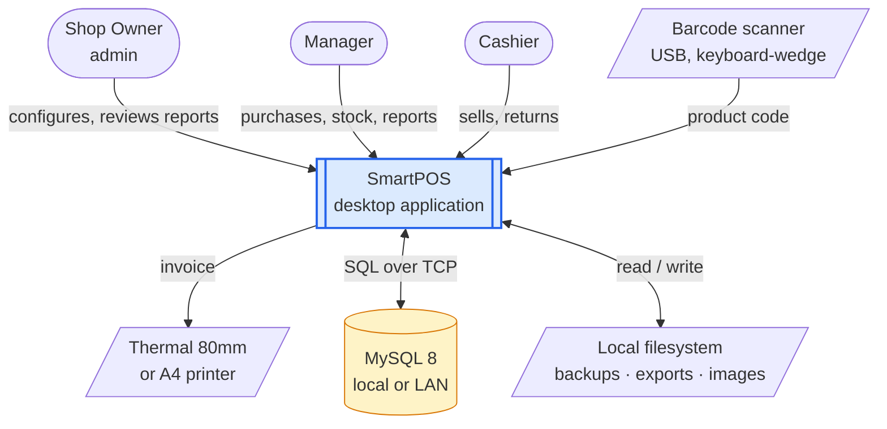

**Deliberately absent:** payment gateway, cloud sync, mobile client, e-mail/SMS.
All are Future Works (proposal §7.2).

The barcode scanner needs no driver or integration — a USB scanner presents
itself as a keyboard, types the code and sends Enter. The POS screen keeps focus
on a hidden input so a scan behaves as typed input terminated by Enter.

---

## 2. Actors and use cases

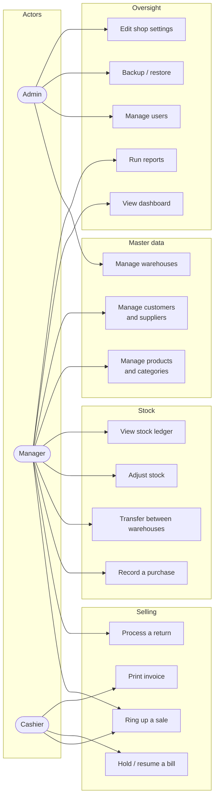

Admin inherits everything Manager can do; Manager inherits everything Cashier
can do. The arrows above show only what each role adds.

---

## 3. Deployment

Two topologies, one codebase. Which one applies is purely a matter of what
`DB_HOST` points at.

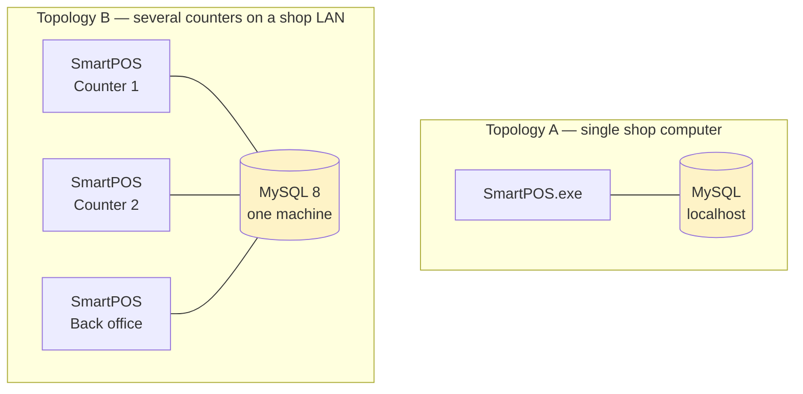

Topology B is what makes the row-locking design in §7 non-negotiable: two
cashiers really can reach for the same last unit at the same instant.

**Development** uses Docker for MySQL only (`docker compose up -d`) — the PyQt5
app needs a display server, which a container does not have, so it runs
natively against the containerised database.

---

## 4. Logical architecture

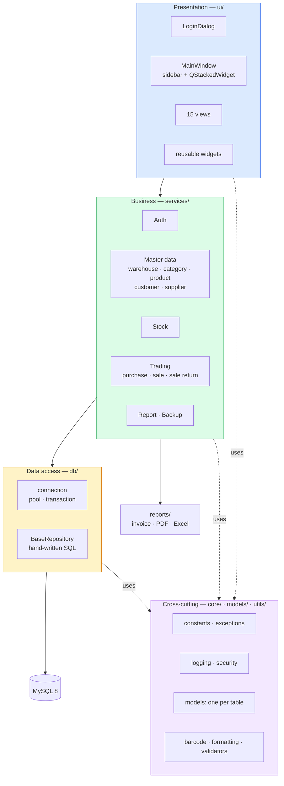

### Why these boundaries

| Rule | Enforced how | What it buys |
|---|---|---|
| No SQL in `ui/` | Review; no `db` import in any view | The database can be re-indexed without re-testing screens |
| No Qt in `services/` | Review; `import PyQt5` banned in `services/` | Business rules run in CI with no display |
| `models/` imports no other layer | Import-direction check in `test_structure.py` | No circular imports as the project grows |
| One write path to stock | `StockService.apply_movement()` | The ledger can always explain the level |

---

## 5. Component catalogue

| # | Component | Responsibility | Principal interface |
|---|---|---|---|
| C1 | `config` | Settings from `.env` | `get_settings() -> Settings` |
| C2 | `db.connection` | Pool, transaction boundary | `transaction()`, `get_connection()` |
| C3 | `db.repository` | SQL helpers | `fetch_one/fetch_all/execute/insert/update/delete` |
| C4 | `core.security` | bcrypt, permission resolution | `hash_password`, `verify_password`, `has_permission` |
| C5 | `AuthService` | Login, session, authorisation | `login`, `current_user`, `require(perm)` |
| C6 | `WarehouseService` | Outlets | `list_all`, `create`, `deactivate` |
| C7 | `CategoryService` | Categories, units | `tree`, `create`, `delete` |
| C8 | `ProductService` | Catalogue, barcodes, CSV | `search`, `get_by_barcode`, `generate_barcode` |
| C9 | `CustomerService` | Customers, dues | `search`, `due_balance`, `collect_due` |
| C10 | `SupplierService` | Suppliers, payables | `search`, `payable_balance`, `pay` |
| C11 | **`StockService`** | **Every stock change** | `apply_movement`, `quantity_on_hand`, `transfer`, `adjust`, `ledger` |
| C12 | `PurchaseService` | Goods in | `create`, `record_payment`, `next_reference_no` |
| C13 | **`SaleService`** | **The counter** | `create`, `hold`, `resume`, `get_by_invoice` |
| C14 | `SaleReturnService` | Goods back | `create`, `returnable_quantities` |
| C15 | `ReportService` | Figures | `dashboard_summary`, `sales_report`, `profit_loss` |
| C16 | `BackupService` | mysqldump / restore | `create_backup`, `restore_backup` |
| C17 | `reports.invoice` | Printing | `render_thermal`, `render_a4`, `print_invoice` |
| C18 | `reports.exporters` | Export | `to_pdf`, `to_excel` |
| C19 | `MainWindow` | Shell, navigation | `build_navigation`, `show_view` |
| C20 | 15 views | One screen each | `refresh()` |

C11 and C13 are the two components that decide whether the project is correct.

---

## 6. Data flow

### Level 0 — context

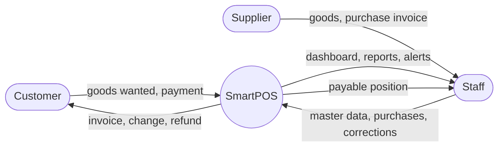

### Level 1 — processes and stores

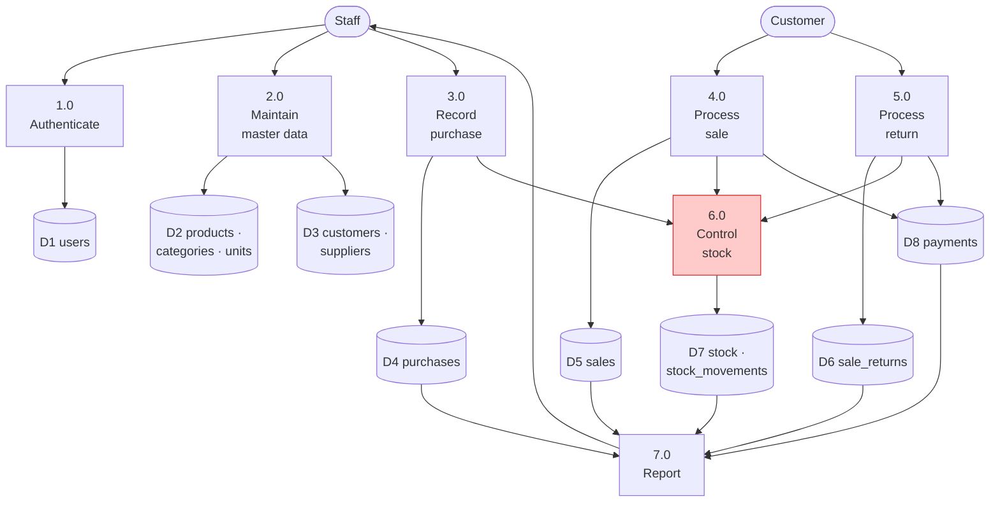

Every process that moves goods routes through **6.0 Control stock**. That is the
design's single most important property: there is no path to D7 that bypasses it.

---

## 7. Process design — the flows that must be right

### 7.1 Completing a sale

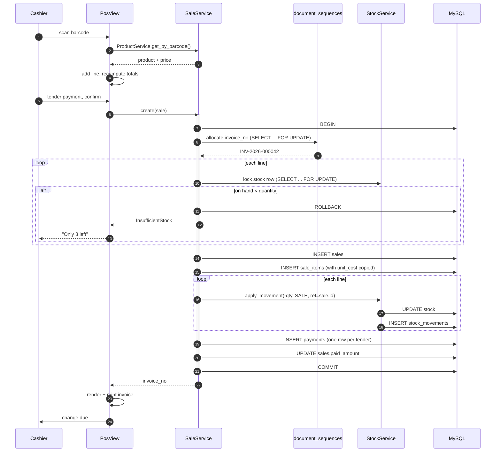

**Design notes**

1. The lock is taken **inside** the transaction, on the `stock` row
   (`UNIQUE(product_id, warehouse_id)`). Checking before `BEGIN` is the classic
   POS bug — two counters both read "1 left" and both sell it.
2. `invoice_no` comes from `document_sequences` in the same transaction, so a
   rolled-back sale returns its number. Gapless, as an invoice book requires.
3. `unit_cost` is copied onto each line, so editing a product's purchase price
   tomorrow does not rewrite today's profit.
4. Lines are locked **in a stable order (by `product_id`)** so two concurrent
   multi-line sales cannot deadlock by locking the same rows in opposite order.

### 7.2 Sale return

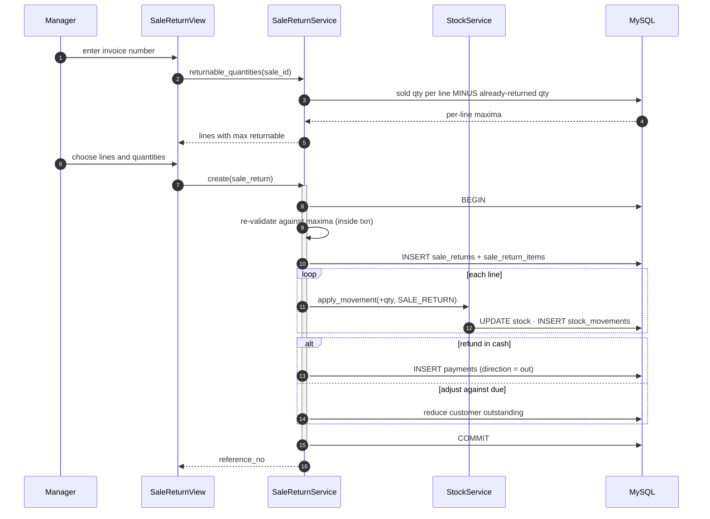

The maxima are re-checked **inside** the transaction. Two managers processing
returns against the same invoice at the same moment must not together return
more than was sold.

### 7.3 Warehouse transfer

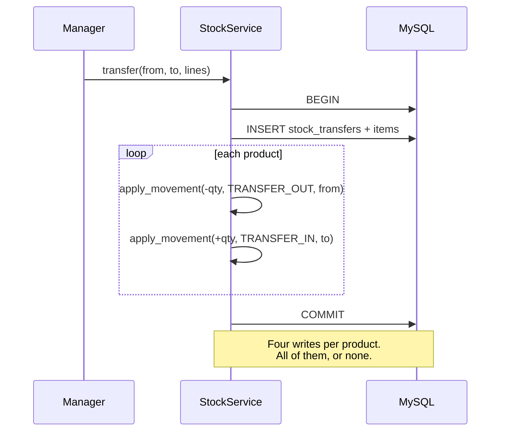

---

## 8. State design

### Sale lifecycle

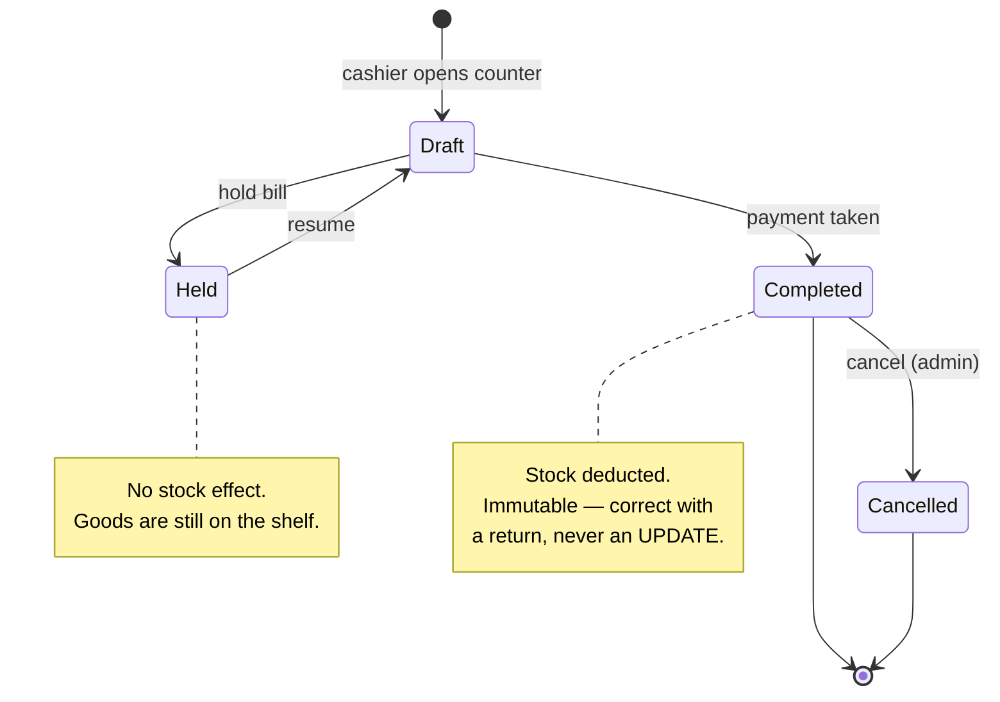

`Draft` exists only in memory; it is never a database row. A bill becomes a row
when it is held or completed.

### Payment status

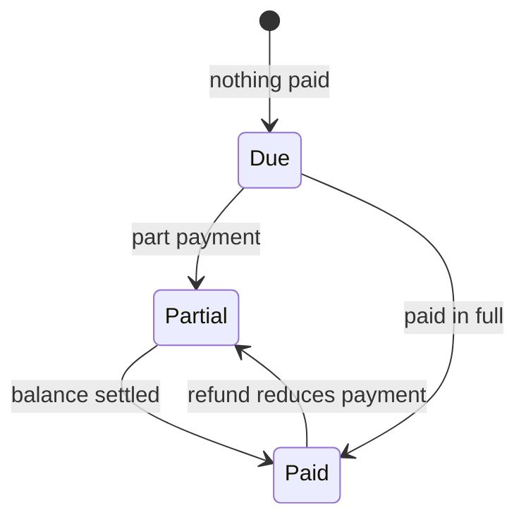

`payment_status` is always derived from `paid_amount` vs `grand_total`, never
set by hand.

---

## 9. Data design

Full column-level specification is in **[DATABASE.md](DATABASE.md)**. The shape
of it:

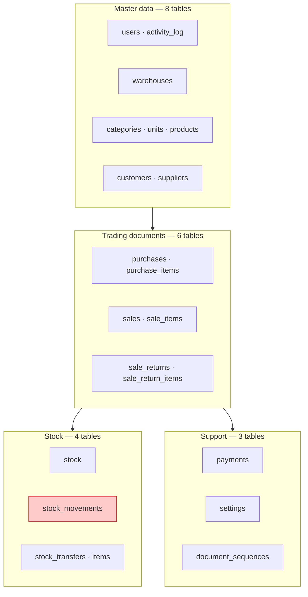

**21 tables.** The invariant that defines correctness:

```sql
-- must return zero rows, always
SELECT product_id, warehouse_id
FROM   stock_movements
GROUP  BY product_id, warehouse_id
HAVING SUM(quantity) <> (SELECT quantity FROM stock s
                         WHERE s.product_id   = stock_movements.product_id
                           AND s.warehouse_id = stock_movements.warehouse_id);
```

| Concern | Decision |
|---|---|
| Money | `DECIMAL(12,2)` lines, `DECIMAL(14,2)` totals — never `FLOAT` |
| Quantity | `DECIMAL(12,3)` — goods sold by weight |
| Master data deletion | Never; `is_active = 0` |
| Completed documents | Immutable; corrected by returns or cancellation |
| Historic cost | Copied to `sale_items.unit_cost` at sale time |
| Engine / isolation | InnoDB, `READ-COMMITTED` |

---

## 10. User interface design

### 10.1 Navigation map

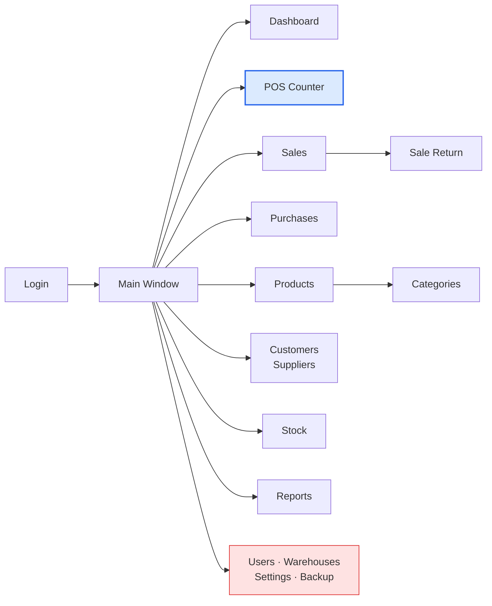

Red = admin only. The POS counter is the default view for a cashier; the
dashboard is the default for manager and admin.

### 10.2 Screen inventory

| # | Screen | Role | Purpose |
|---|---|---|---|
| S1 | Login | all | Authenticate |
| S2 | Dashboard | mgr, admin | Today's figures, trend, low-stock |
| S3 | **POS Counter** | all | Ring up a sale |
| S4 | Sales list | all | Past invoices, filters, reprint |
| S5 | Sale return | mgr, admin | Return against an invoice |
| S6 | Purchase entry | mgr, admin | Goods in |
| S7 | Purchase list | mgr, admin | History, payment status |
| S8 | Products | mgr, admin | Catalogue, barcode labels, CSV |
| S9 | Categories | mgr, admin | Category tree |
| S10 | Customers | all (view) | Profiles, dues, collection |
| S11 | Suppliers | mgr, admin | Profiles, payables, payment |
| S12 | Stock | mgr, admin | Levels, transfer, adjust, ledger |
| S13 | Reports | mgr, admin | Picker + results + export |
| S14 | Users | admin | Accounts and roles |
| S15 | Warehouses | admin | Outlets |
| S16 | Settings & backup | admin | Shop profile, backup/restore |

### 10.3 Main window layout

```
┌────────────────────────────────────────────────────────────────────────┐
│ SmartPOS — Main Outlet                    Md Sabbir (Cashier)   ⏻ Exit │
├──────────────┬─────────────────────────────────────────────────────────┤
│              │                                                         │
│  Dashboard   │                                                         │
│ ▸ POS        │                                                         │
│  Sales       │              QStackedWidget                             │
│  Returns     │              (the active view)                          │
│  Purchases   │                                                         │
│  Products    │                                                         │
│  Customers   │                                                         │
│  Suppliers   │                                                         │
│  Stock       │                                                         │
│  Reports     │                                                         │
│ ─────────────│                                                         │
│  Settings    │                                                         │
│              │                                                         │
├──────────────┴─────────────────────────────────────────────────────────┤
│ Connected · Main Outlet · 28 Sep 2026            Low stock: 7 items    │
└────────────────────────────────────────────────────────────────────────┘
```

Sidebar entries a role cannot use are not disabled — they are **not built**.
A cashier sees five entries, not fifteen greyed-out ones.

### 10.4 POS counter — the screen that matters

```
┌────────────────────────────────────────────────────────────────────────┐
│ Barcode / search  [_________________________]   Customer [Walk-in  ▾]  │
├────────────────────────────────────────────────────────────────────────┤
│  #  Product                    Qty      Price     Disc      Total      │
│  1  Rice Miniket 5kg          2.000    420.00     0.00     840.00      │
│  2  Soyabean Oil 1L           3.000    175.00    10.00     515.00      │
│  3  Salt ACI 1kg              1.000     38.00     0.00      38.00      │
│                                                                        │
│                          (F4 edit qty · Del remove line)               │
├────────────────────────────────────────┬───────────────────────────────┤
│                                        │  Subtotal        1,393.00     │
│  [F2] Hold     [F3] Recall             │  Discount      − 0.00  [ %▾]  │
│  [F9] Return   [Esc] Clear cart        │  Tax           + 0.00         │
│                                        │  ─────────────────────────    │
│                                        │  TOTAL           1,393.00     │
│                                        │                               │
│                                        │  Paid   [ 1500.00 ]           │
│                                        │  Change            107.00     │
│                                        │  Method  ( )Cash ( )Card      │
│                                        │          ( )Mobile ( )Mixed   │
│                                        │                               │
│                                        │   [  F12 — COMPLETE SALE  ]   │
└────────────────────────────────────────┴───────────────────────────────┘
```

**Design rules for this screen**

1. The barcode field holds focus at all times and regains it after every action.
   A scanner types and presses Enter; nothing else may steal that input.
2. Every action has a function key. A busy cashier does not reach for a mouse.
3. Totals recompute on every keystroke, in `Decimal`, never on a timer.
4. `COMPLETE SALE` disables itself while the transaction is in flight, so a
   double-press cannot produce two invoices.
5. Errors appear in place (a red line on the row that failed), not in a modal
   dialog that must be dismissed before the queue can move.

---

## 11. Security design

### 11.1 Permission matrix

Resolved from `core.constants.ROLE_PERMISSIONS`. `AuthService.require(perm)`
raises `PermissionDenied` when a role lacks the entry.

| Permission | Admin | Manager | Cashier |
|---|:---:|:---:|:---:|
| `sale.create` | ● | ● | ● |
| `sale.view` | ● | ● | ● |
| `product.view` | ● | ● | ● |
| `customer.view` | ● | ● | ● |
| `sale_return.create` | ● | ● | — |
| `sale_return.view` | ● | ● | — |
| `purchase.manage` | ● | ● | — |
| `product.manage` | ● | ● | — |
| `category.manage` | ● | ● | — |
| `customer.manage` | ● | ● | — |
| `supplier.manage` | ● | ● | — |
| `stock.manage` | ● | ● | — |
| `warehouse.view` | ● | ● | — |
| `report.view` | ● | ● | — |
| `warehouse.manage` | ● | — | — |
| `user.manage` | ● | — | — |
| `settings.manage` | ● | — | — |
| `backup.manage` | ● | — | — |

Admin holds `"*"`, which matches every permission.

### 11.2 Controls

| Threat | Control |
|---|---|
| Password theft from the database | bcrypt with per-password salt; the plaintext is never stored or logged |
| Privilege escalation through the UI | Permission checked in the **service**, not only by hiding a menu item |
| SQL injection | Parameterised queries only; no string-formatted SQL anywhere |
| Repudiation ("I didn't void that sale") | `activity_log` row + `user_id` on every transactional table |
| Unattended terminal | Idle lock returning to `LoginDialog` after N minutes |
| Credentials in version control | `.env` is git-ignored; `.env.example` carries no real values |
| Data loss | `BackupService`, plus restore tested before the project is called done |

Authorisation is enforced at the service boundary because that is the only
layer every path must cross. Hiding a sidebar button is a convenience, not a
control.

---

## 12. Concurrency and transaction design

Relevant whenever more than one counter runs (Topology B).

| Operation | Isolation strategy |
|---|---|
| Complete a sale | One transaction. `SELECT ... FOR UPDATE` on each `stock` row, **ordered by `product_id`** to avoid deadlock |
| Sale return | One transaction. Re-validate returnable quantity inside it |
| Purchase | One transaction. Lock `stock` rows on the receiving side |
| Warehouse transfer | One transaction spanning both warehouses |
| Allocate a document number | `SELECT ... FOR UPDATE` on `document_sequences`, inside the document's own transaction |
| Reports | Read-only, no locks, may read slightly stale data — acceptable |

**Transaction boundary rule:** a transaction is opened by a *service* method and
never by a repository or a view. A repository that opened its own transaction
would silently break the atomicity of the caller.

**Deadlock handling:** on MySQL error 1213, the service retries the whole
transaction up to 3 times with a short backoff before surfacing the error.

---

## 13. Error handling and logging

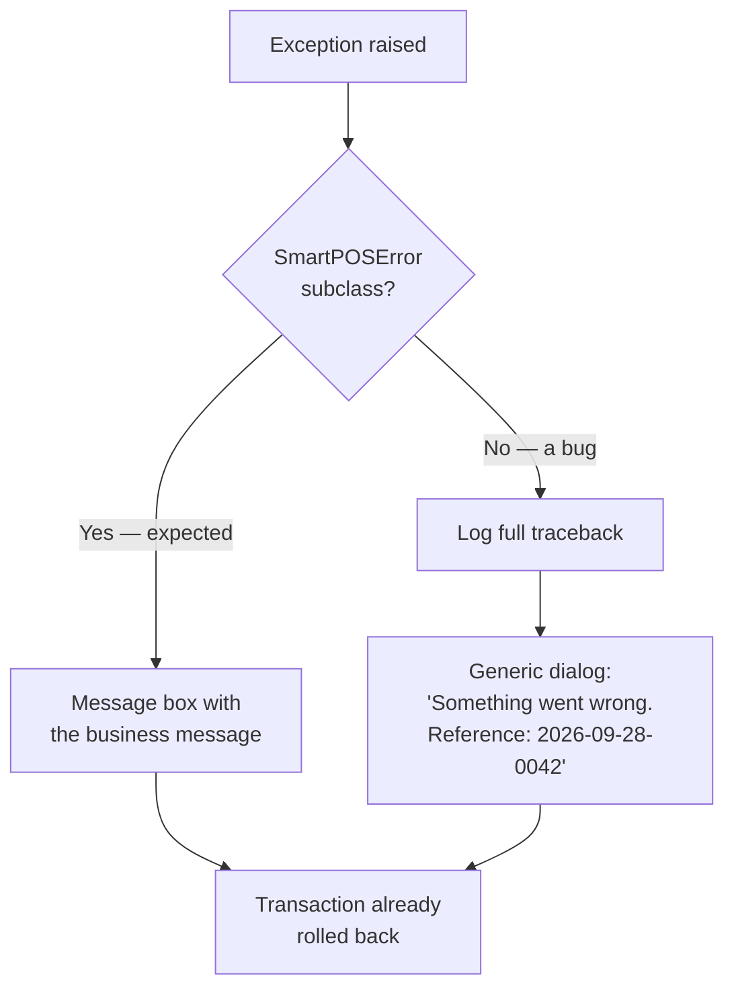

| Exception | Meaning | Shown as |
|---|---|---|
| `ValidationError` | Bad input | Field-level message on the form |
| `InsufficientStock` | Not enough on hand | In-place row error with the available quantity |
| `AuthenticationError` | Bad credentials | Generic "invalid username or password" — never "no such user" |
| `PermissionDenied` | Role too low | "You do not have permission for this action" |
| `DatabaseError` | Server unreachable | Status bar goes red; retry offered |
| anything else | A bug | Logged with traceback, generic dialog with a reference code |

Logs rotate under `logs/`, are never allowed to contain a password or a full
card number, and carry the username and the action for anything transactional.

---

## 14. Backup and recovery

| Aspect | Design |
|---|---|
| Method | `mysqldump`, single transaction, whole schema |
| Naming | `smartpos_YYYYMMDD_HHMMSS.sql` in `BACKUP_DIR` |
| Trigger | Manual from Settings, plus an optional prompt on application close |
| Restore | Admin only; requires typing the word CONFIRM; the current database is dumped first |
| Verification | A restore into an empty schema is part of the definition of done, not an assumption |

Recovery objective for a small shop: **lose at most one day.** A nightly backup
to a USB drive or a synced folder meets it. Anything stronger is out of scope.

---

## 15. Non-functional targets

| Attribute | Target | How it is met |
|---|---|---|
| Barcode lookup | < 50 ms at 5,000 products | Unique index on `products.barcode` |
| Complete a sale | < 5 s scan → printed invoice | Short transaction, no network calls |
| Report over 12 months | < 3 s at 10,000 sales | Composite index `(status, sale_date)` |
| Application start | < 5 s to login dialog | Lazy view construction |
| Concurrent counters | 4 without contention | Row-level locks only; `READ-COMMITTED` |
| Availability | Works with no internet | Local/LAN MySQL; no external dependency |
| Recoverability | ≤ 1 day of data | Nightly backup + tested restore |
| Usability | Trainable in one sitting | Function keys, one screen per task |

---

## 16. Traceability

Every committed feature, to the code that implements it and the tables it
touches. If a row cannot be filled in, the feature is not designed yet.

| Proposal | Feature | Service | Screen | Principal tables |
|---|---|---|---|---|
| 4.1 | Auth & roles | `AuthService` | S1, S14 | `users`, `activity_log` |
| 4.2 | Warehouse | `WarehouseService` | S15 | `warehouses` |
| 4.3 | Product category | `CategoryService` | S9 | `categories`, `units` |
| 4.4 | Product | `ProductService` | S8 | `products` |
| 4.5 | Customer | `CustomerService` | S10 | `customers`, `payments` |
| 4.6 | Supplier | `SupplierService` | S11 | `suppliers`, `payments` |
| 4.7 | Purchase | `PurchaseService` | S6, S7 | `purchases`, `purchase_items`, `stock*` |
| 4.8 | Sale (POS) | `SaleService` | S3, S4 | `sales`, `sale_items`, `stock*`, `payments`, `document_sequences` |
| 4.9 | Sale return | `SaleReturnService` | S5 | `sale_returns`, `sale_return_items`, `stock*`, `payments` |
| 4.10 | Stock | `StockService` | S12 | `stock`, `stock_movements`, `stock_transfers*` |
| 4.11 | Reports & dashboard | `ReportService` | S2, S13 | reads all transactional tables |
| 4.12 | Backup & utilities | `BackupService` | S16 | `settings` |

---

## 17. Packaging and distribution

| Step | Detail |
|---|---|
| Build | PyInstaller one-folder build; one-file is slower to start and hides the config |
| Contents | `SmartPOS.exe`, Qt runtime, `styles.qss`, icons, `.env.example` |
| Database | Not bundled. The installer documents either a local MySQL install or a LAN server address |
| First run | If `.env` is missing, a setup dialog collects the DB host, user and password and writes it |
| Schema | Created by `scripts/init_db.py` on first connection to an empty database |
| Updates | Replace the folder; the schema is versioned by the numbered migration files |

A throwaway PyInstaller build is produced in **week 8**, not week 16 — packaging
failures discovered at the end have no time left to absorb them.

---

## 18. Design risks

| Risk | Consequence | Mitigation |
|---|---|---|
| Stock and ledger drift apart | The system cannot be trusted at all | Single write path; the §9 invariant runs in CI |
| Two counters sell the last unit | Negative stock | Row lock inside the transaction; explicitly tested |
| Deadlock on multi-line sales | Intermittent failures under load | Lock rows ordered by `product_id`; retry on error 1213 |
| Money held as `float` | Rounding errors in every total | `Decimal` end to end; a lint rule bans `float()` on money columns |
| Thermal printer differs from the dev machine's | Invoices unprintable at demo | Test on the real printer by week 12 |
| Held bills treated as sales in reports | Overstated revenue | `status` filter in every report; covered by acceptance criteria |
| Scope creep from Future Works | Nothing finishes | The proposal is the contract; §7.2 stays future |

---

## Appendix A — Terminology

| Term | Meaning here |
|---|---|
| **Warehouse** | Any stock location — a shop floor, a godown, a second outlet |
| **Movement** | One signed change to a stock level, with the document that caused it |
| **Held bill** | A parked cart. Occupies no stock |
| **Due** | Money a customer owes; **payable** is money owed to a supplier |
| **Walk-in** | The default customer row used for anonymous counter sales |
| **Gapless** | A number series with no missing values, as an invoice book requires |
